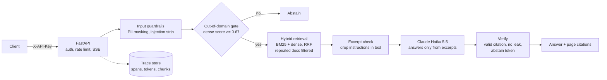
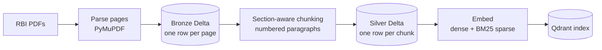

# RBI Regulation RAG

Question answering over public **Reserve Bank of India** regulations, built to be **grounded, measured and shippable**: every answer carries page-level citations, the system abstains when the evidence is missing, and every design choice is backed by a number from an eval you can re-run.

> **Live demo:** _coming soon (Hugging Face Spaces)_ · Production-**style** (tested, containerised, observable), not production-at-scale. See [Scope and limitations](#scope-and-limitations).

```text
Q: What is the shortest cooling-off period a lender can set for a digital loan?

A: The shortest permitted cooling-off period is one day. The Board of the regulated entity
   sets the period in its loan policy, but it cannot be less than one day [1].

   [1] Digital Lending Directions, 2025 · para 10 · p.10 · status: current
```

## Highlights

| | |
|---|---|
| **Hybrid retrieval beats pure vector search** | MRR@10 **0.772** (BM25 + dense, RRF) vs 0.716 dense-only vs 0.649 BM25-only |
| **Version-aware** | Repealed rules are filtered out unless the question asks about them. Without this, a repealed document reached the top 3 for **30%** of questions |
| **Grounded or silent** | Answers without a valid citation are withheld; 100% abstention on unanswerable and off-topic questions in the golden set |
| **PII never reaches the model** | PAN / Aadhaar / phone / card / email masked before retrieval, LLM and logs: **100% → 0%** of PII-bearing requests sent to the LLM, with no change in answer quality |
| **Re-runnable evals** | 51-question golden set, hit@k / MRR / faithfulness / citation accuracy, tracked in MLflow, gated in CI |
| **Cheap** | Haiku-class model end to end. The whole project, including every eval run, cost **under $0.10** in API spend |

## How it works

**Request path**



**Build path** (runs at image build time, so the container starts offline in ~2 s)



- **Ingestion** is idempotent: chunks are keyed by a content hash and merged into Delta tables, so re-running never duplicates rows (tested).
- **Chunking** splits on RBI's numbered paragraphs, keeps `(doc, para, pages)` metadata and prefixes each chunk with its section title, which is what makes page-level citations possible.
- **Retrieval** runs dense (`bge-small-en-v1.5`) and BM25 as sparse vectors in one Qdrant collection and fuses them with Reciprocal Rank Fusion.
- **Generation** is constrained to numbered excerpts, must cite `[n]`, and must emit `INSUFFICIENT_EVIDENCE` when the excerpts do not answer the question.
- **Streaming** tokens are provisional. Citations are verified only when generation ends, so the final event carries the verified answer (or the abstain message).

## Corpus

Seven public RBI documents, 392 pages, 949 chunks. Two are **deliberately superseded** documents that exist to test version handling.

| Document | Status |
|---|---|
| Digital Lending Directions, 2025 | current |
| Digital Lending Guidelines, 2022 | repealed by the 2025 Directions |
| Commercial Banks, Responsible Business Conduct Directions, 2025 (updated Oct 2026) | current |
| NBFC, Managing Risks in Outsourcing Directions, 2025 | current |
| RBI Integrated Ombudsman Scheme, 2026 | current |
| RBI Integrated Ombudsman Scheme, 2021 | repealed by the 2026 Scheme (1 Jul 2026) |
| KYC Master Direction, 2016 (Aug 2025 update) | snapshot, may be superseded by the Nov 2025 entity-wise Directions |

Sources, effective dates and supersession are recorded in [`data/manifest.yaml`](data/manifest.yaml).

## Results

Retrieval eval: 40 answerable questions, paragraph-level gold labels (`doc, para, pages`). **One question is worth 2.5 points**, so treat differences under ~5 points as noise.

| Config | hit@1 | hit@5 | MRR@10 | p50 latency |
|---|---|---|---|---|
| Dense only (naive baseline) | 0.625 | 0.850 | 0.716 | 11 ms |
| BM25 only | 0.550 | 0.850 | 0.649 | 19 ms |
| **Hybrid (RRF)** | **0.675** | 0.900 | **0.772** | 29 ms |
| Hybrid + cross-encoder rerank | 0.600 | 0.925 | 0.738 | ~3,300 ms |
| Hybrid + contextual doc header | 0.625 | 0.900 | 0.736 | 60 ms |
| Hybrid + rerank, **no version filter** | 0.550 | 0.900 | 0.696 | ~3,300 ms |

**What did not work, and why it is kept in the table:** the MS-MARCO cross-encoder lowered MRR and was ~100x slower on CPU; prepending the document title to chunks did not help overall. The shipped config is plain hybrid RRF.

End-to-end generation eval (Claude Haiku 5.5 generates and judges), 42 answerable questions plus unanswerable, off-topic, injection and PII cases:

| | Dense | Hybrid, no guardrails | **Hybrid + guardrails** |
|---|---|---|---|
| Answered when answerable | 90.5% | 95.2% | 95.2% |
| Cited the gold paragraph | 92.1% | 95.0% | 95.0% |
| Correct (judge) | 90.3% | 97.0% | 100% |
| Faithful to excerpts (judge) | 100% | 100% | 100% |
| Abstained when unanswerable | 100% | 100% | 100% |
| Refused off-topic | 100% | 100% | 100% |
| **PII sent to the LLM** | 0% | **100%** | **0%** |

The two answerable questions the system abstains on are retrieval misses; it says "not found" instead of guessing.

**Read these numbers with the caveats in mind:** small sample sizes; the judge is the same model family as the generator (self-preference bias is possible, so faithfulness of 100% should be spot-checked, not trusted); the golden set was drafted semi-automatically, each label is tied to a verbatim source quote that CI re-validates, and a human review pass is tracked in the `verified` field of [`evals/golden/questions.jsonl`](evals/golden/questions.jsonl).

## Guardrails

Rule-based on purpose: deterministic, free, unit-tested (35 cases, including false-positive checks on real regulatory text).

- **PII masking** before retrieval, the LLM and logs: PAN, Aadhaar, phone (+91), card (Luhn-checked), email. Official `@rbi.org.in` addresses are preserved in answers.
- **Prompt injection**: injected sentences are stripped from a question while the legitimate part is answered; pure injections are blocked without an LLM call; retrieved excerpts that contain instructions are dropped; the system prompt treats question and excerpts as data. The detector flags 0 of 949 corpus chunks.
- **Off-topic**: a dense-score gate refuses out-of-domain questions without an LLM call. The 0.67 threshold separates the 3 off-topic golden questions from every answerable one, but it was set on a small sample; corpus-adjacent unanswerable questions are not separable by score and are left to the model's abstention.
- **Output checks**: answers that leak the prompt or secrets are withheld.

## API

| Endpoint | Purpose |
|---|---|
| `GET /health` | status, chunks indexed (no auth) |
| `POST /ask` | full answer with citations, guardrail info, tokens and cost |
| `POST /ask/stream` | Server-Sent Events: `meta`, `token`*, `final` (verified) |
| `GET /traces`, `/traces/summary`, `/traces/{id}` | per-request spans and aggregates (admin key only) |

```bash
curl -s -X POST localhost:8000/ask \
  -H "X-API-Key: $API_KEY" -H "content-type: application/json" \
  -d '{"question": "Where must a bank publish its model locker agreement?"}'
```

Auth is an `X-API-Key` header (constant-time compare), rate limiting is per key with `429` + `Retry-After`, and a spend guard returns `503` once the configured budget is used. Every request gets an id and a trace (guardrails, gate score, retrieved chunks with scores, tokens, cost, first-token latency); traces hold only masked text.

## Run it

```bash
uv sync --all-extras
cp .env.example .env                       # add ANTHROPIC_API_KEY, API_KEYS
uv run python -m rbirag.ingest.pipeline    # PDFs -> Delta (bronze/silver)
uv run python -m rbirag.retrieval.index    # Delta -> Qdrant
uv run uvicorn rbirag.api.app:create_app --factory --port 8000
```

```bash
docker build -t rbi-rag .                  # ~283 MB, bakes corpus + index + models
docker run -p 7860:7860 --env-file .env rbi-rag
```

```bash
uv run pytest                              # 81 tests, no network or API key needed
uv run python -m rbirag.evals_retrieval    # ablation, free, logs to MLflow (mlflow ui)
uv run python -m rbirag.evals_generation   # end-to-end eval, ~$0.05 with Haiku
uv run python evals/check_regression.py    # the CI gate
```

**CI** (GitHub Actions): lint, corpus rebuild from the committed PDFs, tests, a **retrieval regression gate** that fails the build if hit@k or MRR drop more than 0.03 below the committed baseline, and a Docker build plus smoke test. None of it needs secrets or LLM calls.

## Repo layout

```text
src/rbirag/
  ingest/         parse (PyMuPDF), section-aware chunker, idempotent Delta pipeline
  retrieval/      Qdrant index build, dense / BM25 / hybrid search, optional rerank
  generation/     prompt, cached LLM client with spend guard, pipeline with citation checks
  guardrails/     PII masking, injection screening, output checks
  api/            FastAPI app, auth, rate limiter
  observability/  spans, trace store
  evals_*.py      retrieval and generation evals (MLflow)
evals/            golden set, label validator, CI regression gate, baselines
data/             manifest + source PDFs
```

## Scope and limitations

Stated plainly, because they matter more than the features:

- **Demo-grade serving.** One worker (the embedded Qdrant index is single-process), an in-memory rate limiter, ephemeral traces and LLM cache. No autoscaling, no multi-tenant auth. The spend guard resets with the container, so the real budget cap is the one set in the Anthropic console.
- **Small corpus, small eval.** 7 documents and ~40 scored questions. Differences between configs are indicative, not statistically significant.
- **Regulatory content moves.** The KYC document is an August 2025 snapshot that RBI later re-issued as entity-wise Directions. Answers are **not legal or compliance advice**; always check the cited source.
- **Guardrails are rules, not a model.** English only, Indian ID formats only, and bypassable by determined adversaries. The injection test set is small.
- **Databricks-compatible, not Databricks-hosted.** Bronze/silver tables are Delta Lake (delta-rs) and eval runs are MLflow, both of which run unchanged on Databricks; this project was run locally.
